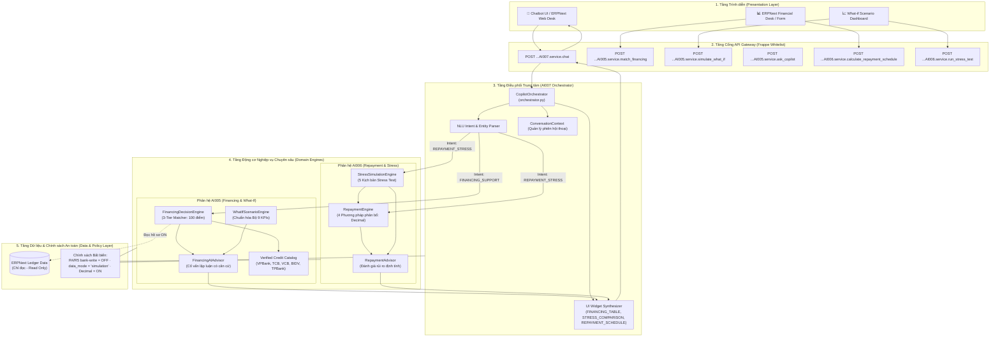
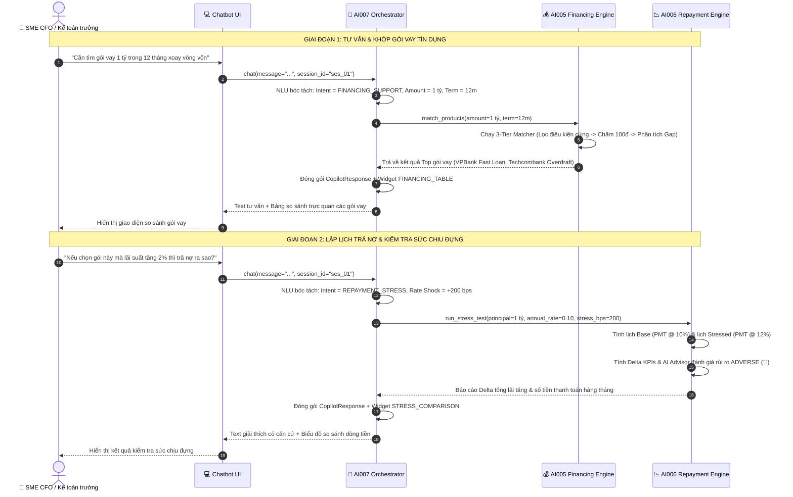

# Lotus Fin — Master Architecture Specification: Bộ 3 Phân Hệ Trợ Lý Tài Chính Thông Minh (AI005 · AI006 · AI007)


## 1. Tổng quan Bộ 3 Module AI Cốt lõi

Hệ sinh thái Lotus Fin Copilot được phân rã thành **3 phân hệ chuyên biệt**, tách bạch tuyệt đối giữa **tầng nhận thức / điều phối ngôn ngữ (Cognitive Orchestration)** và **tầng tính toán tài chính tất định (Deterministic Quantitative Engines)**:

| Phân hệ | Tên Module | Vai trò Kiến trúc | Nhiệm vụ Trọng tâm |
| :---: | :--- | :--- | :--- |
| **`AI007`** | **Financial Copilot Orchestrator** | Central Router & Multi-Turn Coordinator *(Bộ não điều phối)* | • Tiếp nhận câu hỏi tự nhiên từ Web/Chatbot Desk.<br>• Phân loại Intent & bóc tách thực thể tài chính.<br>• Định tuyến gọi chéo sang AI005 hoặc AI006.<br>• Đóng gói phản hồi đa phương thức kèm **UI Widgets**. |
| **`AI005`** | **Financing Decision Support & 9 KPIs Engine** | Deterministic Matcher & What-If Simulator *(Khớp tín dụng & Mô phỏng)* | • Đối soát điều kiện vay với biểu phí 5 ngân hàng lớn qua **3-Tier Matcher** (Hard filter $\rightarrow$ Chấm điểm 100đ $\rightarrow$ Gap analysis).<br>• Mô phỏng kịch bản dòng tiền chuẩn hóa **Bộ 9 KPIs**.<br>• Cố vấn AI lập luận Trade-off và cảnh báo thâm hụt tiền. |
| **`AI006`** | **Deterministic Repayment & Stress Simulation** | Quantitative Amortization & Risk Engine *(Lịch trả nợ & Stress Test)* | • Lập lịch trả nợ chi tiết từng kỳ theo 4 phương pháp (`EQUAL_INSTALLMENT`, `EQUAL_PRINCIPAL`, `FLAT_RATE`, `BULLET`).<br>• Chạy bài kiểm tra sức chịu đựng qua 5 kịch bản Stress Test.<br>• Cố vấn AI phân tích Delta chỉ số và đánh giá rủi ro `ADVERSE`/`FAVORABLE`. |

---

## 2. Sơ đồ Kiến trúc Khối Toàn hệ thống (System Architecture)



---

## 3. Sơ đồ Luồng Tương tác Toàn trình (End-to-End Sequence Diagram)



---

## 4. Tóm tắt Chi tiết Nghiệp vụ Từng Phân Hệ

### 4.1. Module AI005 — Financing Matcher & 9 KPIs What-If
* **3-Tier Matcher:**
  * *Vòng 1 (Hard Filter):* Sàng lọc hạn mức tối thiểu/tối đa, kỳ hạn, doanh thu tối thiểu, thời gian hoạt động, ngưỡng DSCR và tài sản bảo đảm.
  * *Vòng 2 (100-Point Scoring):* Chấm điểm theo trọng số: Chi phí lãi vay (40đ), Độ phù hợp năng lực tài chính (35đ), Tốc độ giải ngân (25đ).
  * *Vòng 3 (Gap Analysis):* Sắp xếp xếp hạng và chỉ ra các tiêu chí chưa đạt (Missing Criteria).
* **Bộ 9 KPIs What-If chuẩn hóa:**
  1. `revenue`: Doanh thu mô phỏng theo tỷ lệ biến động sales.
  2. `gross_profit`: Lợi nhuận gộp sau giá vốn.
  3. `gross_margin`: Biên lợi nhuận gộp.
  4. `ar_outstanding`: Số dư khoản phải thu khách hàng.
  5. `dso`: Kỳ thu tiền bình quân.
  6. `net_cash_flow`: Dòng tiền thuần trong kỳ.
  7. `ending_cash`: Số dư tiền mặt đóng kỳ.
  8. `ccc`: Chu kỳ chuyển đổi tiền mặt (Cash Conversion Cycle).
  9. `cash_shortfall`: Mức độ thâm hụt so với đệm tiền an toàn.
* **Tài liệu chi tiết:** Xem tại [`AI005/README.md`](AI005/README.md).

---

### 4.2. Module AI006 — Repayment & Stress Simulation Engine
* **4 Phương pháp phân bổ nợ:**
  * `EQUAL_INSTALLMENT`: Trả góp đều (PMT), gốc tăng dần, lãi giảm dần, thanh toán cố định.
  * `EQUAL_PRINCIPAL`: Trả gốc đều mỗi kỳ, lãi giảm dần theo dư nợ thực tế.
  * `FLAT_RATE`: Lãi phẳng cố định trên nợ gốc ban đầu suốt kỳ vay.
  * `BULLET`: Trả lãi định kỳ, gốc tất toán toàn bộ ở kỳ đáo hạn cuối cùng.
* **5 Kịch bản Stress Test:**
  * `RATE_SHOCK`: Sốc lãi suất thả nổi tăng đột biến (+bps).
  * `TERM_EXTENSION`: Kéo dài kỳ hạn để hạ số tiền thanh toán định kỳ.
  * `EARLY_REPAYMENT`: Tất toán trước hạn tại kỳ thứ $t$ kèm phí phạt hợp đồng.
  * `GRACE_PERIOD`: Bổ sung ân hạn gốc đầu kỳ.
  * `COMBINED`: Phối hợp đa rủi ro.
* **Tài liệu chi tiết:** Xem tại [`AI006/README.md`](AI006/README.md).

---

### 4.3. Module AI007 — Financial Copilot Orchestrator
* **Ma trận định tuyến (Routing Matrix):**
  * Ý định `FINANCING_SUPPORT` $\rightarrow$ Điều hướng tới `AI005` $\rightarrow$ Xuất widget `FINANCING_TABLE`.
  * Ý định `REPAYMENT_STRESS` (không shock) $\rightarrow$ Điều hướng tới `AI006.RepaymentEngine` $\rightarrow$ Xuất widget `REPAYMENT_SCHEDULE`.
  * Ý định `REPAYMENT_STRESS` (có shock) $\rightarrow$ Điều hướng tới `AI006.StressSimulationEngine` $\rightarrow$ Xuất widget `STRESS_COMPARISON`.
  * Ý định `GENERAL_QA` $\rightarrow$ Xử lý hội thoại tự nhiên, đưa ra gợi ý bước tiếp theo.
* **Quản lý ngữ cảnh đa lượt:** Duy trì đối tượng `ConversationContext` theo từng `session_id`.
* **Tài liệu chi tiết:** Xem tại [`AI007/README.md`](AI007/README.md).

---

## 5. Cấu trúc Thư mục & Tài nguyên Thiết kế (Assets)

```
lotus_fin/lotus_fin/
├── AI005/                                # Phân hệ Financing & 9 KPIs
│   ├── models.py, matcher.py, scenario_engine.py, ai_advisor.py, service.py
│   ├── AI005_architecture.puml           # Mã nguồn PlantUML phân hệ AI005
│   ├── AI005_architecture.xmi            # File mô hình Astah UML phân hệ AI005
│   └── README.md                         # Tài liệu chi tiết AI005
├── AI006/                                # Phân hệ Repayment & Stress
│   ├── models.py, engine.py, stress.py, ai_advisor.py, service.py
│   ├── AI006_architecture.puml           # Mã nguồn PlantUML phân hệ AI006
│   ├── AI006_architecture.xmi            # File mô hình Astah UML phân hệ AI006
│   └── README.md                         # Tài liệu chi tiết AI006
├── AI007/                                # Phân hệ Central Orchestrator
│   ├── models.py, orchestrator.py, service.py
│   ├── AI007_architecture.puml           # Mã nguồn PlantUML phân hệ AI007
│   ├── AI007_architecture.xmi            # File mô hình Astah UML phân hệ AI007
│   └── README.md                         # Tài liệu chi tiết AI007
├── LotusFin_AI_Overall_Architecture.puml # Mã nguồn PlantUML TỔNG THỂ cả 3 AI
├── LotusFin_AI_Overall_Architecture.xmi  # File mô hình Astah UML TỔNG THỂ cả 3 AI
└── README_AI_005_006_007.md              # File Tổng hợp Kiến trúc Toàn diện (File này)
```

---

## 6. Hướng dẫn Mở & Sử dụng trên Astah Professional

Trên máy tính đã cài đặt **Astah Professional** (`C:\Program Files\astah-professional`), bạn mở toàn bộ mô hình kiến trúc theo 2 bước:

1. **Khởi động Astah Professional** $\rightarrow$ Chọn menu:
   $$\text{File} \longrightarrow \text{Import} \longrightarrow \text{XMI (XML)...}$$
2. **Chọn file `.xmi` muốn làm việc:**
   * **Mô hình Tổng thể 3 Phân hệ:** [`LotusFin_AI_Overall_Architecture.xmi`](LotusFin_AI_Overall_Architecture.xmi)
   * **Mô hình riêng AI005:** [`AI005/AI005_architecture.xmi`](AI005/AI005_architecture.xmi)
   * **Mô hình riêng AI006:** [`AI006/AI006_architecture.xmi`](AI006/AI006_architecture.xmi)
   * **Mô hình riêng AI007:** [`AI007/AI007_architecture.xmi`](AI007/AI007_architecture.xmi)

Toàn bộ các gói (Packages), Lớp (Classes), Thuộc tính (Attributes), Phương thức (Operations) và Quan hệ phụ thuộc sẽ xuất hiện đầy đủ trong cây thư mục **Project Structure** của Astah.

---

## 7. Danh mục Toàn bộ REST API Endpoints (Frappe Whitelist)

| Phân hệ | Endpoint REST API | Tham số chính | Chức năng nghiệp vụ |
| :---: | :--- | :--- | :--- |
| **`AI007`** | `POST ...AI007.service.chat` | `message`, `session_id`, `context` | Cổng hội thoại duy nhất cho Copilot (Tự động NLU + Routing + Widgets). |
| **`AI005`** | `POST ...AI005.service.ask_copilot` | `company`, `query` | Hỏi đáp ngôn ngữ tự nhiên chuyên biệt về nhu cầu vay vốn. |
| **`AI005`** | `POST ...AI005.service.match_financing` | `company`, `amount`, `term_months`, `purpose` | Khớp trực tiếp gói tín dụng qua 3-Tier Matcher. |
| **`AI005`** | `POST ...AI005.service.simulate_what_if` | `company`, `sales_change_pct`, `collection_delay_days`, ... | Chạy mô phỏng kịch bản dòng tiền chuẩn hóa 9 KPIs. |
| **`AI006`** | `POST ...AI006.service.calculate_repayment_schedule` | `principal`, `annual_rate`, `term_months`, `amortization_method` | Tính toán lịch trả nợ tất định từng kỳ. |
| **`AI006`** | `POST ...AI006.service.run_stress_test` | `principal`, `annual_rate`, `term_months`, `stress_type`, `rate_shock_bps` | Kiểm tra sức chịu đựng tài chính trước biến động lãi suất. |

---

## 8. Các Ràng buộc Bất biến An toàn (Security & Compliance Invariants)

1. **`R4/R5 bank-write = OFF`:**
   * Tuyệt đối không gửi hồ sơ vay đến cổng ngân hàng.
   * Không tự động cam kết bảo lãnh tín dụng; mọi kết quả là khuyến nghị hỗ trợ ra quyết định.
2. **`data_mode = 'simulation'`:**
   * Toàn bộ dữ liệu xuất ra từ AI005, AI006, AI007 bắt buộc gắn cờ mô phỏng.
   * Tuyệt đối không tạo bút toán giả mạo vào Sổ cái Kế toán (`General Ledger`) của ERPNext.
3. **`Strict Decimal Precision`:**
   * Sử dụng số học `Decimal` với cơ chế làm tròn `ROUND_HALF_UP` cho toàn bộ phép tính tiền tệ, triệt tiêu hoàn toàn sai số trôi dạt dấu phẩy động (float drift), đảm bảo số dư nợ kỳ cuối luôn về chính xác `0.00`.
4. **`Grounded AI (Zero Hallucination)`:**
   * Mọi con số trong câu trả lời tự nhiên của AI Advisor đều được trích xuất trực tiếp từ các động cơ tính toán tất định. AI không tự ý nội suy hoặc bịa đặt dữ liệu lãi suất hay chi phí.
